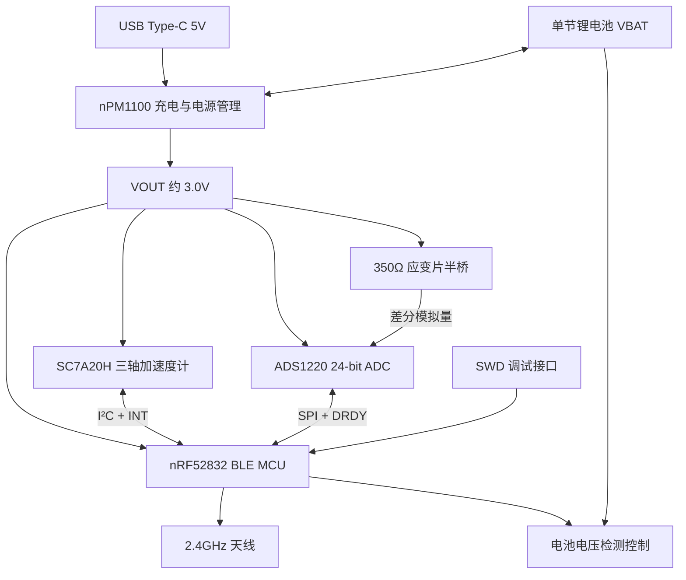

# CadenceSensor 公路车曲柄功率计硬件设计方案

> 文档状态：硬件方案整理稿（2026-10-30）  
> 设计目的：第一版可充电蓝牙曲柄功率计硬件验证平台  
> 资料依据：`SCH_Schematic1_V0.9.pdf`（六页）以及后续“已完成修改”的说明  
> **版本说明：**修改后的最终原理图尚未提供，以下明确区分“V0.9 已核实的连接”“按修改目标描述的连接”和“打样前待核对事项”。不能将本文件视为最终 ERC/DRC 通过证明。

## 1. 设计目标

以 nRF52832 为主控，通过 SC7A20H 三轴加速度计测量曲柄运动、ADS1220 高精度 ADC 采集双应变片电桥信号，计算曲柄踏频、扭矩和功率，并通过 BLE 无线发送数据。采用单节可充电锂电池、USB Type-C 充电、SWD 程序下载与调试。

**系统架构：**

## 2. 主器件与功能

| 模块 | 型号/核心元件 | 作用 |
|---|---|---|
| 主控 | nRF52832-QFAA | 数据采集、运算、BLE 通信、低功耗管理 |
| 加速度计 | SC7A20HTR | 采集曲柄运动、提供加速度与中断 |
| 精密 ADC | ADS1220IPWR | 24 位 ADC，采样应变电桥的微弱差分电压 |
| 充电/稳压 | nPM1100-QDAA-R | 单节锂电池充电及降压供电 |
| 应变测量 | SG1、SG2（外接 350Ω 应变片）；R4、R16（350Ω） | 双有源应变片半桥 |
| 电池电压采样 | DMC2400UV（Q1）、R6、R7 等 | 受控电阻分压采样 |
| 无线天线 | AN2051-245 | 2.4GHz BLE 射频辐射 |
| 充电接口 | U262-161N-4BVC11 | USB Type-C 5V 输入 |
| 调试接口 | H2，1×5、2.54mm | SWDIO、SWDCLK、RESET、VTref 和 GND |

## 3. 电源与充电系统

### 3.1 电源网络

| 电源网络 | 来源 | 用途/说明 |
|---|---|---|
| `VBUS` | USB Type-C VBUS | nPM1100 USB 输入，标称 5V |
| `VBAT` | 单节锂电池 | nPM1100 电池端、电池电压检测 |
| `VSYS` | nPM1100 系统电源节点 | 电源路径中间节点；**不直接当作 3.0V 逻辑电源** |
| `VOUT` | nPM1100 降压输出 | MCU、传感器、ADC 与桥路所用的约 3.0V 电源 |
| `GND` | 公共地 | 数字、模拟、USB 与电池负端的参考地；PCB 做合理回流布局 |

V0.9 中 `VOUTBSET1`、`VOUTBSET0` 按 nPM1100 的 3.0V 输出目标配置。**第 3、4 脚的库符号文字仍应以官方封装定义校验**：3脚为 `VOUTBSET0`，4脚为 `AVSS`，不能仅凭错误符号文字判断连线。

### 3.2 USB Type-C

- 两组 VBUS 插针并入 `VBUS`，两组 GND 插针接 `GND`。
- `CC1`、`CC2` 分别通过 R9、R8（各 5.1kΩ）接 GND，以声明 5V 受电端。
- A6/B6（D+）并为 `D_P`、A7/B7（D−）并为 `D_N`，连接 nPM1100 的 D+/D−；**不用于 nRF52832 USB 数据传输**。
- SBU 未使用；接口外壳按 ESD/接地方案处理。
- 建议预留合适的 VBUS TVS 和 USB 数据脚 ESD 防护。

**打样检查重点：**V0.9 右侧 USB 连接器的 VBUS 与 SHELL/GND 线段在图面上存在疑似共线连接。虽然已反馈完成修改，但最终版必须在 EDA 中高亮 `VBUS` 和 `GND` 并测网络表，确认两者绝无短接。

### 3.3 nPM1100 外围（V0.9 所示）

| 元件/引脚 | V0.9 参数或连接 | 说明 |
|---|---|---|
| U2 | nPM1100-QDAA-R | 电源管理 IC |
| L2 | 2.2µH | Buck 储能电感，SW → VOUT |
| C8 | 10µF | VOUT 输出滤波 |
| C6 | 10µF | DEC 节点去耦 |
| C9 | 2.2µF | VBUS 输入去耦 |
| C11 | 10µF | VSYS 去耦 |
| C2 | 1µF | VBAT 端去耦 |
| R11 | 30kΩ | ICHG 设置电阻；实际充电电流需以官方公式与最终配置核算 |
| R12 | 10kΩ | NTC 脚固定电阻方案；**不等于真实温度检测** |
| CHG / ERR | LED5、LED6 | 充电及错误状态指示 |
| MODE / ISET | MCU GPIO | 由固件配置工作模式/充电设置 |
| SHPACT / SHPHLD | 见下节 | Ship Mode 进入与唤醒控制 |

电池应采用具备过充、过放、过流及适当温度保护的电池包；若采用真实 NTC，需按电池的 NTC 类型和芯片要求重新设计 R12 所在网络。

### 3.4 Ship Mode 及实体按键（按修改目标记录，**待新版原理图确认**）

- `SHPACT`：由 MCU 输出控制进入 Ship Mode，不可把 `VBAT` 按键直接接入 3.0V MCU GPIO。
- `SHPHLD`：通过实体按键拉低用于唤醒；若被 `VBAT` 上拉，不可直接接 nRF52832 的 GPIO。
- 设备进入 Ship Mode 后 MCU 可能失电，因此唤醒必须保留不依赖 MCU 的硬件路径。
- 上次 V0.9 出现 SW2/SW3、R24=500kΩ、R25=100kΩ；最终版这些器件是否仍保留及其最终连接方式尚待核实。

### 3.5 电池电压检测

V0.9 采用 Q1（DMC2400UV）控制电阻分压支路：

- `BAT_MON_EN`：MCU P0.06，控制检测支路开启/关闭。
- `BAT_MON`：MCU P0.02 / AIN0，用于 SAADC 采集。
- R6 = 1.5MΩ，R7 = 220kΩ，R3/R5 各 1MΩ（与 Q1 组成控制电路）。
- 假设检测支路开启、Q1 处于导通状态，忽略开关压降：

  \[
  V_{BAT\_MON}=V_{BAT}\frac{220}{1500+220}\approx 0.1279V_{BAT}
  \]

  \[
  V_{BAT}\approx 7.818V_{BAT\_MON}
  \]

实际应考虑电阻误差、ADC 参考与增益、开关泄漏及电池状态，进行电压标定。只在采样窗口开启分压支路以降低静态功耗。

## 4. nRF52832 主控与射频

### 4.1 核心供电、时钟和调试

- U3：nRF52832-QFAA，VDD（13、36、48脚）全部接 `VOUT`；GND/裸露焊盘可靠接地。
- 32MHz 高频晶振 X1，C15、C16 标示为 12pF；数值需结合实际晶振 CL、寄生电容复核。
- 当前未设置独立 32.768kHz 晶振；固件可按内部低频 RC 时钟策略配置并校准。
- C14=47µF、C19=100nF、C22=100nF、C23=4.7µF、C18=100nF 等按各引脚和功能节点就近布置，不能随意合并。
- V0.9 的 DC/DC 与参考外围包含 L3=15nH、L6=10µH、C24=1µF；RF 链路包含 L5=3.9nH、C17=0.8pF、C21=100pF 等，需按 Nordic 对应 QFAA 版本参考布局校验。
- RF 匹配网络至 AN2051-245 天线的走线需控制阻抗、缩短匹配元件间连接，并满足天线净空规则；金属曲柄安装环境需实测 BLE 信号。

### 4.2 GPIO 与通信信号分配（取自 V0.9）

| nRF52832 引脚 | 网络名 | 连接目标 | 用途 |
|---|---|---|---|
| P0.02 / AIN0 | `BAT_MON` | 电池分压电路 | ADC 检测电池电压 |
| P0.06 | `BAT_MON_EN` | Q1 检测开关 | 使能电池检测 |
| P0.07 | `MODE` | nPM1100 MODE | 电源/充电模式控制 |
| P0.08 | `ISET` | nPM1100 ISET | 充电相关设置 |
| P0.09 | `SHPHLD`（V0.9） | nPM1100 | **修改目标为不直接连接 MCU；待新版核实** |
| P0.10 | `SHPACT` | nPM1100 | Ship Mode 进入控制；需避免 VBAT 过压 |
| P0.11 | `P0.11` | SW1 | 用户按键输入 |
| P0.12 | `P0.12` | LED8 | 可控状态指示灯 |
| P0.13 | `ACC_INT1` | SC7A20H INT1 | 运动中断 |
| P0.14 | `ACC_SDA` | SC7A20H SDx | I²C SDA |
| P0.15 | `ACC_SCL` | SC7A20H SCx | I²C SCL |
| P0.16 | `ADS_SCK` | ADS1220 SCLK | SPI SCK |
| P0.17 | `ADS_MOSI` | ADS1220 DIN | SPI MOSI |
| P0.18 | `ADS_MISO` | ADS1220 DOUT/DRDY | SPI MISO |
| P0.19 | `ADS_CS` | ADS1220 CS# | SPI 片选 |
| P0.20 | `ADS_DRDY` | ADS1220 DRDY# | ADC 数据就绪中断 |
| P0.21 / RESET | `P0.21` | RESET 按键、H2 | 复位/调试 |
| SWDIO | `SWDIO` | H2 | SWD 数据 |
| SWDCLK | `SWDCLK` | H2 | SWD 时钟 |

未分配的 GPIO 可留作扩展，但应遵守相关引脚复用和上电默认状态要求。

## 5. SC7A20H 加速度计

- U1：SC7A20HTR，VDD 与 VDDIO 接 `VOUT`；GND 与 GNDIO 接 `GND`。
- CS 引脚拉高，采用 I²C；SDO 拉高，按当前设计使用预期的 7 位 I²C 地址 `0x19`（需固件扫描/读 WHO_AM_I 确认）。
- R1=4.7kΩ 上拉 `ACC_SCL`，R2=4.7kΩ 上拉 `ACC_SDA`。
- C1、C3 各 100nF，分别为相关电源脚去耦，实际 PCB 靠近 U1。
- INT1 连接 nRF52832 P0.13；INT2 在 V0.9 仅引出网络 `ACC_INT2`，没有看到与 MCU 对应连接。
- 固件由 I²C 设置采样率、量程、中断和低功耗模式，结合曲柄周期性运动解算踏频。

## 6. ADS1220 与双应变片半桥

### 6.1 ADC 数字接口

U4：ADS1220IPWR，AVDD / DVDD 接 `VOUT`，AVSS / DGND 接 `GND`，C4、C5 各 100nF 去耦。CLK 接地，使用芯片内部时钟。

| ADS1220 引脚 | 网络名 | MCU GPIO | 其他 |
|---|---|---|---|
| 1 SCLK | `ADS_SCK` | P0.16 | 串联 R19=47Ω |
| 2 CS# | `ADS_CS` | P0.19 | 串联 R18=47Ω |
| 16 DIN | `ADS_MOSI` | P0.17 | 串联 R20=47Ω |
| 15 DOUT/DRDY# | `ADS_MISO` | P0.18 | 串联 R21=47Ω |
| 14 DRDY# | `ADS_DRDY` | P0.20 | 串联 R17=47Ω |
| 11 AIN0/REFP1 | `ADS_AIN0` | — | 差分模拟输入 |
| 10 AIN1 | `ADS_AIN1` | — | 差分模拟输入 |

### 6.2 半桥结构

- SG1、SG2：预留外接 350Ω 应变片焊点/接插件，构成桥路左侧上下臂。
- R4、R16：各 350Ω，构成桥路右侧上下臂；优先选择匹配精度与低温漂的精密电阻。
- 上端：`VOUT` 激励；下端：`GND`（V0.9 所示）。
- 两个桥臂中点分别为 `AIN−` 与 `AIN+`，通过 R22=1kΩ、R23=1kΩ 连接至 ADC 的 AIN0/AIN1。
- C7=100nF 跨接 ADC 两路输入，构成差分低通抗干扰网络。
- 应变片应根据曲柄受力方向与拉压状态对称布置，完成零点、方向、温度和扭矩标定。

### 6.3 激励功耗与低功耗改造

在 3.0V、四个桥臂名义电阻均为 350Ω 时，连续激励电流约为：

\[
I_{bridge}=2\times\frac{3.0}{350+350}=8.57\ \mathrm{mA}
\]

即约 25.7mW。**V0.9 为电桥持续供电**；后续可能已改成可控激励，但未见新图，因此不在文档中认定它已经实现。

可选优化：增加电桥高边供电开关，或者评估 ADS1220 的集成低侧开关方案；须重新考虑采样前稳定时间、桥路参考、开关压降、漏电及温漂。ADC 配置可评估采用与桥路激励对应的比例式参考（如 AVDD–AVSS）；具体增益、参考选择、数据速率和滤波参数在固件阶段确定。

## 7. 调试、按键和指示灯

### 7.1 H2 SWD 连接器

| H2 引脚 | 网络 | 说明 |
|---|---|---|
| 1 | GND | 参考地 |
| 2 | VOUT | VTref，约 3.0V，供 J-Link 检测目标逻辑电压 |
| 3 | P0.21 | nRF RESET |
| 4 | SWDCLK | SWD 时钟 |
| 5 | SWDIO | SWD 数据 |

注意 H2 的排针顺序是**自定义板端定义**，不代表任意 J-Link 线缆的默认排针顺序，制作适配线前需逐针核对。

### 7.2 指示灯与人机交互

- SW1：MCU 用户按键 P0.11。
- MCU RESET 按键：P0.21 拉低复位。
- LED8：P0.12 受控指示灯（R15=1kΩ）。
- LED7：V0.9 连接 VOUT、R13=1kΩ，持续点亮；建议取消、改为 GPIO 控制或打样时设为不焊。
- LED4：V0.9 连接 VSYS、R10=1kΩ，也可能持续耗电；请按所需工作/Ship Mode 电流目标处理。
- LED5/LED6：nPM1100 的 CHG/ERR 指示灯。

## 8. 固件预期工作流程

1. 系统上电后初始化 nRF52832、GPIO、I²C、SPI、BLE 与中断。
2. 读取 SC7A20H 的身份寄存器，初始化运动检测和中断参数。
3. 配置 ADS1220 参考电压、输入通道、PGA、采样速率和滤波模式。
4. 按固定时序采集桥路差分 ADC 码值，扣除零点并换算标定后的扭矩。
5. 根据加速度周期特征估计踏频，再求角速度 `ω = 2π × cadence / 60`。
6. 由 `P = T × ω` 计算机械功率；输出 BLE 数据。该公式以扭矩和角速度为有效标定量为前提。
7. 间歇开启 `BAT_MON_EN`，读取电池电压并计算状态。
8. 无运动或超时后降低采样和广播频率；满足关机条件时通过电源管理模块进入低功耗或 Ship Mode。

> 注：BLE 的具体服务/广播格式（例如是否实现 Cycling Power Service）、扭矩标定系数、采样与滤波算法均属于**固件规划**，未由 V0.9 硬件图确定。

## 9. 重要元件规格与选型要求

| 分类 | 参数/要求 | 设计依据 |
|---|---|---|
| 供电 | 单节锂电池；VOUT 约 3.0V | nPM1100 输出设置 |
| nPM1100 Buck | L2=2.2µH，输出 C8=10µF | V0.9 |
| MCU HFCLK | 32MHz X1，C15/C16=12pF（待按实际晶振核算） | V0.9 |
| 加速度计 I²C | SDA/SCL 各 4.7kΩ 上拉 | V0.9 |
| ADC SPI | SCK、CS、MOSI、MISO、DRDY 各 47Ω 串阻 | V0.9 |
| 电桥固定电阻 | R4、R16=350Ω，建议 0.1% 或更好、低温漂 | V0.9 数值 + 工程建议 |
| 模拟输入滤波 | R22/R23 各 1kΩ，C7=100nF | V0.9 |
| 电池电压检测 | R6=1.5MΩ，R7=220kΩ | V0.9 |
| USB CC 下拉 | R8/R9 各 5.1kΩ | V0.9 |
| RF 布局 | 天线区净空、匹配、接地、阻抗控制 | PCB 设计要求 |

电容耐压、陶瓷介质、DC Bias 降额、电感饱和电流、按键封装和电池接插件极性，应结合最终物料手册复核，V0.9 原理图未给出全部采购规格。

## 10. PCB 布局与打样前检查

- **电源：**充电 IC、SW 电感、输出电容组成紧凑开关回路；各芯片去耦电容尽量靠近对应管脚。
- **模拟：**ADS1220 与桥路输入远离 SW 节点、USB 输入和 2.4GHz 射频走线；AIN+ / AIN− 尽量等长、靠近，并避免高频回流穿过模拟区域。
- **射频：**按 nRF52832 和具体天线参考布局确认 RF 匹配网络、地平面、keep-out 与外壳/金属曲柄距离。
- **机械：**考虑曲柄离心载荷、震动、浸水、密封、电池固定、应变片引线应力释放及焊接可靠性。
- **测试点：**建议预留 `VBUS`、`VBAT`、`VSYS`、`VOUT`、`GND`、`BAT_MON`、`AIN+`、`AIN−`、`SWDIO`、`SWDCLK`、`RESET`。
- **打样前必须：**运行 ERC；核对所有跨页网络名；确保 VBUS 与 GND 无短接；检查所有芯片封装引脚；运行 PCB DRC。

## 11. 最终版修改确认表

以下项目**在 V0.9 中存在，用户表示已做修改，但目前尚无新原理图可核实**：

- [ ] `SHPHLD` 不再被 VBAT 上拉后直接连接 MCU P0.09。
- [ ] `SHPACT` 按键不再直接把 VBAT 施加到 MCU P0.10。
- [ ] 已确认可在 MCU 失电时通过实体按键唤醒 Ship Mode。
- [ ] USB Type-C `VBUS` 与 `GND` 无误连。
- [ ] 电池包保护和温度保护方案已确定。
- [ ] nPM1100 第3/4脚库符号及焊盘编号已核对。
- [ ] LED4、LED7 常亮功耗已经评估。
- [ ] 如使用桥路电源开关，最新连接和 ADC 参考策略已同步更新。

**结论：**这是一套用于第一版公路车曲柄功率计验证的完整硬件架构，包括 BLE MCU、运动传感器、应变 ADC、电桥、锂电池充电、电池监测与 SWD 调试。硬件已经具备进一步 PCB 设计和软件开发的基础；最终安全性与连线准确性须以用户最新原理图及 ERC/DRC 结果为准。
