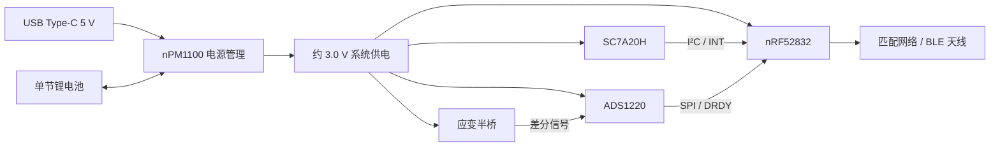

# CadenceSensor

基于 **nRF52832 + SC7A20H + ADS1220 + nPM1100** 的公路车踏频与曲柄功率计硬件原型项目。

设计目标是采集曲柄运动及应变电桥信号，经标定计算踏频、扭矩和功率，并通过 BLE 发送数据。项目采用单节可充电锂电池、USB Type-C 充电和板载 2.4 GHz 芯片天线。

> **当前阶段：硬件设计与样机验证准备。** 仓库包含原理图、PCB 工程、制造导出资料和设计评审记录，尚未包含固件代码。算法、BLE 服务、测量精度、续航及整机可靠性均需后续实现和实测，不能将设计目标视为已验证指标。
>
> **许可：非商业使用。** 允许按 [LICENSE](LICENSE) 学习、修改、分享及非商业打样；商业使用须取得权利人另行书面授权。本项目采用自定义非商业许可，不属于 [OSI 定义](https://opensource.org/osd)下的开源许可。

## 硬件组成

| 模块 | 主要器件 | 功能 |
| --- | --- | --- |
| 主控与无线 | nRF52832-QFAA | 采集控制、运算、BLE 通信及低功耗管理 |
| 运动检测 | SC7A20HTR | I²C 三轴加速度采集及运动中断 |
| 应变采集 | ADS1220IPWR | SPI 接口、24 位差分 ADC，采集应变电桥信号 |
| 电桥 | 两片外接 350 Ω 应变片及精密补桥电阻 | 双有源应变片半桥，需结合曲柄安装和加载标定 |
| 电源管理 | nPM1100-QDAA-R | 单节锂电池充电、电源路径管理及约 3.0 V 降压供电 |
| 射频 | AN2051-245 | 板载 2.4 GHz 芯片天线及匹配网络 |
| 调试与交互 | SWD、按键、LED、蜂鸣器 | 下载调试、复位、状态提示及关机/唤醒控制 |

PCB 设计采用四层板，当前板体约 **20 × 45 mm**。具体器件取值、封装、引脚与叠层以准备打样的同一版本工程及导出文件为准。



USB Type-C 用于供电和充电；当前设计不提供 nRF52832 USB 数据接口，也不使用 USB PD 快充。电池温度检测脚采用固定 10 kΩ 电阻方案，**不提供真实电池温度检测**。

## 仓库结构

```text
CadenceSensor/
├── README.md
├── LICENSE                         # 项目专用非商业许可
├── THIRD_PARTY_NOTICES.md           # 厂商资料与第三方权利说明
├── Doc/                            # 设计方案、改进建议及历次评审记录
└── Hardware/
    ├── CadenceSensor.eprj2          # 立创 EDA 专业版工程
    ├── PCB/                        # PCB 工程副本、BOM、PDF、网络表及 Gerber
    ├── 原理图/
    │   └── Schematic1/             # 分页 SVG 原理图
    └── 元器件/                     # 数据手册及厂商参考设计
```

所有层级的 `_backup/`、`*_backup/` 目录不纳入 Git。`tmp/` 中的本地审阅中间产物及根目录整体复制压缩包也被忽略；原理图历史压缩包、BOM、Gerber 和工程文件保留版本管理。

## 查看与使用

1. 用**立创 EDA 专业版**打开 [工程文件](Hardware/CadenceSensor.eprj2)。当前已有资料由专业版 3.2.181 导出，使用兼容版本编辑。
2. 无需 EDA 软件时，可直接查看 [SVG 原理图](Hardware/原理图/Schematic1/) 和 [PCB 导出资料](Hardware/PCB/)。
3. 编辑后，从同一版本工程重新生成原理图、BOM、网络表、PCB PDF 和 Gerber，核对位号、厂家型号及封装，避免混用不同时间的导出物。
4. 投板前重新铺铜、运行 DRC 与原理图/PCB 一致性检查，并核查 RF 匹配、天线净空、去耦回路、阻抗及装配工艺。

`Hardware/PCB/` 中保存有工程副本。编辑及导出前应确认其与主工程的版本关系；文件名中的日期本身不能证明内容一致。历次评审仅适用于报告记录的版本和文件哈希，**DRC 通过也不能替代功能与射频验证**。

## 接口与验证

| 接口 | 当前设计用途 |
| --- | --- |
| USB Type-C | 5 V 输入及电池充电 |
| Battery | 单节锂电池连接，接线前核对极性与电池保护 |
| SG1 / SG2 | 外接应变片，接线和安装后进行零点及已知力矩标定 |
| H3 | SWD 调试：1 GND、2 VOUT/VTref、3 RESET、4 SWDCLK、5 SWDIO |
| 按键 | 硬件开机/关机、复位及用户输入，具体行为由连接及固件共同决定 |

建议先限流上电测电源，再验证 SWD、两组晶振、I²C/SPI、BLE、ADC 与加载标定，最后测试蜂鸣器/无线并发、按键及 GPIO 关机、按键/USB 唤醒和 Ship 电流。自动关机策略、踏频/功率算法及低功耗参数需要固件实现。

## 设计文档

- [硬件设计方案](Doc/CadenceSensor_Hardware_Design.md)：早期方案及设计背景，其中旧位号和取值不替代最新工程。
- [电路与功能改进建议](Doc/CadenceSensor_Circuit_Function_Improvements.md)。
- [四层 PCB 布局规划](Doc/CadenceSensor_4Layer_PCB_Layout_Plan.md)。
- [PCB 第三次评审记录](Doc/CadenceSensor_PCB_Review_2026-11-01_R3.txt)：2026-11-01 09:25 导出版本的评审快照。
- [其余原理图与 PCB 评审记录](Doc/)：按日期、轮次及报告内哈希区分版本。

早期讨论曾采用其他加速度计、应变阻值或无线方案；当前硬件说明以本 README 和对应工程为入口。功率精度与续航应在实测后记录，不采用早期方案目标作为宣传指标。

## 非商业许可

本项目原创内容采用 **CadenceSensor Non-Commercial License 1.0**，标识为 `LicenseRef-CadenceSensor-NonCommercial-1.0`。完整条款见 [LICENSE](LICENSE)。

- 允许非商业学习、研究、修改、分享和个人制作；保留版权、许可说明并标注修改。
- 允许为非商业原型委托第三方制板/贴片并支付加工费用；加工方不得据此自行销售本设计产品。
- 未经另行书面授权，不得销售设计资料、PCB、套件或成品，也不得用于商业产品、企业内部商业研发、收费服务或其他商业活动。

厂商数据手册、参考工程、库文件及其他第三方内容适用各自的权利与许可，不因本项目的许可声明而重新授权，详见 [第三方说明](THIRD_PARTY_NOTICES.md)。商业授权请联系项目权利人。
