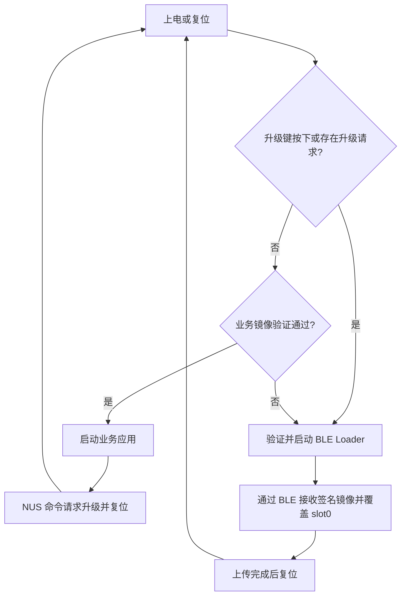

# nRF52832 单业务槽 BLE OTA 技术方案

## 1. 方案结论与适用范围

采用 **MCUboot firmware loader 模式 + 独立 BLE Loader + 单业务镜像槽**。正常运行业务应用；升级时复位进入 Loader，通过 MCUmgr 的 SMP over BLE 接收签名业务镜像，直接覆盖业务槽。

- 不保留旧业务镜像，不支持回滚。
- MCUboot 和 Loader 固定保留，第一阶段不通过 OTA 更新。
- 下载中断或业务镜像损坏时，进入 Loader，重新上传完整镜像恢复。
- 首次部署通过 SWD 烧录 MCUboot、Loader 和初始业务镜像；后续通过 BLE 更新业务应用。

**本文为原始设计依据。** 已完成工程内 Loader 移植、三镜像编译、fireDAP 烧录和真实 BLE OTA；实际配置、命令与验证边界见 [实现与实机验证记录](BLE_OTA_Implementation_and_Validation.md)。下文示例保留设计阶段写法，实际工程使用自定义 `FIRMWARE_LOADER_IMAGE_CADENCE`，替代内置 BLE Loader 选择。

### 当前工程依据

| 项目 | 已检查的配置或产物 |
|---|---|
| SDK | nRF Connect SDK v3.2.4 |
| 板级目标 | `cadence_sensor/nrf52832` |
| 芯片容量配置 | 512 KB Flash、64 KB RAM |
| 蓝牙 | SoftDevice Controller、BLE Peripheral、NUS 串口 |
| 业务外设 | I²C、SC7A20H |
| 升级按键 | SW5，P0.11，现有节点 `user_button` |
| 现有构建产物 | 约 107.4 KB Flash、24.6 KB 静态 RAM；不代表加入 OTA 后的占用或运行峰值 |

## 2. 系统架构与内存布局

### 程序职责

| 程序 | 职责 | 链接分区 |
|---|---|---|
| MCUboot | 检查升级入口、验证镜像、选择启动目标 | `boot_partition` |
| 业务应用 | NUS 通信、传感器采集、请求进入升级模式 | `slot0_partition` |
| BLE Loader | SMP 广播与连接、业务镜像上传、Flash 写入和重启 | `slot1_partition` |

`slot1` 固定存放 Loader，不是备用业务槽或下载缓存区。三个程序分别编译、链接，分阶段运行；RAM 可在程序切换后复用，容量检查分别进行，不能将三个程序的 RAM 占用相加。



图中假设 Loader 自身有效；Loader 无效且业务应用也不可启动时，需要 SWD 恢复。

### 初始 Flash 预算

| 区域 | 起始地址 | 大小 | 结束地址，不含 |
|---|---:|---:|---:|
| MCUboot | `0x00000` | 64 KB | `0x10000` |
| 业务槽 `slot0` | `0x10000` | 240 KB | `0x4C000` |
| Loader 槽 `slot1` | `0x4C000` | 192 KB | `0x7C000` |
| 参数存储 | `0x7C000` | 16 KB | `0x80000` |

所有分区按 4 KB 擦除页对齐，不需要 scratch 分区。业务槽和 Loader 槽均须容纳镜像头、签名 TLV 及构建工具要求的其他开销。

**必须先测量 MCUboot 和 Loader，再确定最终分区。** BLE Loader 包含 Zephyr、BLE 协议栈和 MCUmgr，并非几 KB 的程序。参考示例的分区预留不能当作实测占用；如果 Loader 超过预算，需要裁剪或调整布局。不能预先承诺单槽方案能大幅增加业务空间。

使用 DTS 描述公共分区，让应用、MCUboot 和 Loader 共享相同的地址、尺寸和节点标签。建议增加板级 `cadence_sensor_partitions.dtsi`，由板级 DTS 引入。检查各镜像最终生成的 `zephyr.dts`，避免仅在业务 `app.overlay` 中定义分区。

## 3. 工程组织与核心配置

使用唯一开启 sysbuild 的顶层 `build` 配置，统一构建三个独立镜像。当前 NCS 3.2.4 同时承载 ANT、BLE 和 OTA；构建命令见 [项目说明](../README.md)。

```text
nRF52832_Demo/
├─ prj.conf                       业务配置
├─ app.overlay                    业务专用 overlay
├─ sysbuild.conf                  启动链、签名、Loader 选择
├─ sysbuild/
│  ├─ mcuboot.conf                MCUboot 配置
│  ├─ mcuboot.overlay             MCUboot 专用 overlay
│  ├─ ble_mcumgr.conf             Loader 配置调整
│  └─ ble_mcumgr.overlay          Loader 专用 overlay
├─ boards/others/cadence_sensor/
│  └─ cadence_sensor_partitions.dtsi
├─ src/
│  └─ app/
│     └─ ota_entry.c              业务升级入口
└─ doc/
   └─ BLE_OTA_Single_Slot_Design.md
```

上述为拟采用的组织方式，新增配置文件需要在构建后确认被 sysbuild 正确加载。不要把业务应用整个 `app.overlay` 复用于 Loader，其中的 NUS 控制台选择不适用于 Loader。

### sysbuild.conf

```ini
SB_CONFIG_BOOTLOADER_MCUBOOT=y
SB_CONFIG_MCUBOOT_MODE_FIRMWARE_UPDATER=y
SB_CONFIG_FIRMWARE_LOADER_IMAGE_BLE_MCUMGR=y
SB_CONFIG_MCUBOOT_MODE_FIRMWARE_UPDATER_BOOT_MODE_ENTRANCE=y
SB_CONFIG_BOOT_SIGNATURE_TYPE_ECDSA_P256=y
```

签名密钥通过 `SB_CONFIG_BOOT_SIGNATURE_KEY_FILE` 指定。MCUboot 内置对应公钥，业务应用和 Loader 使用同一签名密钥。发布前使用自有密钥，私钥不随固件分发，也不提交到公开仓库。

不选择 swap、overwrite-only 或普通 `SB_CONFIG_MCUBOOT_MODE_SINGLE_APP`。普通 single-app 模式本身不提供 BLE OTA 能力。

### MCUboot 配置

在 `sysbuild/mcuboot.conf` 中明确配置：

```ini
CONFIG_GPIO=y
CONFIG_BOOT_FIRMWARE_LOADER_ENTRANCE_GPIO=y
CONFIG_BOOT_FIRMWARE_LOADER_NO_APPLICATION=y
CONFIG_BOOT_VALIDATE_SLOT0=y
```

完整镜像验证用于识别写入中断、损坏或错误签名。不能只凭有效镜像头判断业务镜像可启动。MCUboot 使用物理 UART 或 RTT 调试，不依赖 NUS。

### 业务应用配置

- 通过 sysbuild 构建 MCUboot 兼容镜像，核对最终 `CONFIG_BOOTLOADER_MCUBOOT=y` 及 firmware updater 模式配置。
- 通过 `zephyr,code-partition` 链接到 `slot0_partition`，不再从 Flash 地址 0 运行。
- 保留现有 NUS、I²C 和传感器功能，增加升级入口模块。
- 业务应用不需要完整的 MCUmgr 镜像上传服务；该服务放在 Loader 中。
- 不使用 swap 的镜像测试、确认和回滚流程。
- 固件版本写入签名镜像元数据，更新包保持分区和签名密钥兼容。

## 4. 升级入口与 Loader 适配

### 按键入口

使用 SW5 按住后复位进入 Loader。现有 `user_button` 还需增加 MCUboot 使用的别名：

```dts
/ {
    aliases {
        mcuboot-button0 = &user_button;
    };
};
```

该入口不依赖业务应用正常工作，必须保留。第一阶段不把每次普通 RESET 都解释为升级请求。

### NUS 软件入口

业务应用收到例如 `OTA ENTER` 后，将请求交给业务线程或工作项处理，设置启动模式，再复位。逻辑示意：

```c
int err = bootmode_set(BOOT_MODE_TYPE_BOOTLOADER);

if (err == 0) {
    /* 实际实现应安排延迟，让 NUS 响应有机会发送完成。 */
    sys_reboot(SYS_REBOOT_COLD);
}
```

使用 `<zephyr/retention/bootmode.h>` 和复位接口，检查返回值；不要在 BLE 接收回调中执行阻塞操作。

nRF52832 的 `gpregret1` 可用于保存软件复位前的启动请求。参考定义：

```dts
/ {
    chosen {
        zephyr,boot-mode = &boot_mode0;
    };
};

&gpregret1 {
    status = "okay";

    boot_mode0: boot_mode@0 {
        compatible = "zephyr,retention";
        status = "okay";
        reg = <0x0 0x1>;
    };
};
```

应用和 MCUboot 采用相同定义，避免其他功能占用该寄存器。MCUboot 消费后清除请求。GPREGRET 请求不承担断电恢复职责；断电后根据业务镜像有效性和按键决定启动目标。

### BLE Loader 适配清单

优先复用 SDK 的 `ble_mcumgr`，通过工程内配置适配，避免直接修改 SDK 源码：

| 项目 | 规划 |
|---|---|
| 参考工程 | `nrf/samples/mcuboot/firmware_loader_entrance` 的 nRF52840 配置 |
| 蓝牙控制器 | 使用现有 SoftDevice Controller，在 Loader overlay 中选择对应 HCI 节点 |
| BLE 服务 | SMP over BLE；不需要 NUS |
| 广播 | SMP UUID，名称建议 `CadenceDFU` 或包含设备标识 |
| 缓冲区 | 从 MTU 247 或更小开始，按 64 KB RAM 预算调整连接数、缓冲区和线程栈 |
| 外设与组件 | 关闭 I²C、ADC、Shell、文件系统和无关管理命令 |
| 日志 | 联调期保留 UART/RTT，稳定后再裁剪 |
| Flash 写入 | 确认 Loader 在 `slot1` 运行，业务上传目标为 `slot0` |

Loader 的所有写入、擦除命令必须限制目标范围，拒绝修改 MCUboot、Loader 和参数区。关闭无关的存储擦除功能；检查并验证 nRF52832 的硬件 Flash 保护方式，不能仅依赖手机客户端正确操作。

本机 SDK 有相近 nRF52 平台参考，不等于 nRF52832 已验证可直接使用。需要实际解决控制器选择、板级搜索路径、分区、签名和资源占用问题。若内置 Loader 的平台专用配置阻碍适配，可基于 SMP 服务建立工程内 Loader，由 sysbuild 作为自定义 firmware loader 镜像纳入构建。

## 5. 更新流程、恢复边界与实施验收

### 正常更新流程

1. 首次通过 SWD 烧录 MCUboot、签名 Loader 和签名初始业务镜像。
2. 按住 SW5 复位，或通过业务 NUS 命令请求进入 Loader。
3. 手机重新扫描、连接 Loader，使用 nRF Connect Device Manager 上传签名业务更新包。
4. Loader 将数据写入 `slot0`，完成后复位；不执行双槽 swap 的 test/confirm 流程。
5. MCUboot 完整验证业务镜像，验证通过后启动业务应用。
6. 手机重新连接业务设备，确认版本、NUS 通信和传感器采集正常。

使用构建生成且与 Loader 模式匹配的业务签名更新包。不要发送裸 `zephyr.bin`，也不要把包含 MCUboot、Loader 的整机烧录镜像作为业务 OTA 包。传输成功不替代 MCUboot 最终的镜像验证。

### 异常行为

| 情况 | 预期结果 |
|---|---|
| 进入 Loader 后尚未修改业务槽就断电 | 原业务镜像仍有效，下次可正常启动 |
| 擦除或写入业务槽时断电 | 镜像验证失败，进入 Loader，重新上传 |
| BLE 断开 | Loader 保持可重连，允许重试；重启后按镜像有效性选择启动目标 |
| 错误签名、损坏或不完整镜像 | MCUboot 拒绝启动，进入 Loader；旧业务可能已经被覆盖 |
| 镜像签名正确，但业务运行后卡死 | 不会自动回滚，使用按键进入 Loader 修复 |
| MCUboot 或 Loader 被破坏 | BLE 恢复能力可能丢失，需要 SWD |

第一阶段仅保证重新上传完整包恢复，不承诺跨断电续传。重新上传必须正确处理旧的残留数据。Loader 等待期间不应超时跳入未验证的业务镜像。

watchdog 只能触发复位，不能单独保证运行故障自动进入 Loader。自动故障恢复可后续增加启动次数或健康状态机制，本阶段保留按键恢复。

参数区不随业务升级擦除；业务固件需考虑参数结构版本与兼容性。签名保证固件可信，但单槽覆盖不能保证错误包被拒绝时旧业务仍可运行。

### 实施阶段与验收标准

| 阶段 | 工作 | 验收标准 |
|---|---|---|
| 1. 启动链 | 公共分区、MCUboot、Loader、业务应用的 sysbuild 构建 | 三镜像地址正确；正常启动业务；按键可进入 Loader；空业务槽可进入 Loader |
| 2. BLE 更新 | Loader 的 nRF52832 适配、手机上传第二版本 | 无需 SWD 完成一次业务升级；NUS 和 I²C 正常 |
| 3. 恢复与边界 | 断电、断连、错误签名、超大镜像、错误目标槽 | 可通过 Loader 重试；固定程序及参数区不被破坏 |
| 4. 固化与体验 | 实测空间、裁剪、冻结分区、软件入口 | 记录 Flash/RAM 余量；NUS 可请求升级；更新包可重复生成 |

构建检查包括各镜像最终 `.config`、`zephyr.dts`、链接地址、签名结果及内存报告。硬件测试覆盖擦除初期、写入中段和上传末尾断电，并在升级前后核对固定区和参数区内容。

日常通过 SWD 调试时避免整片擦除 MCUboot、Loader 和参数区。最终分区冻结后，常规业务 OTA 不再改变槽地址、尺寸和签名信任关系。

## 6. 参考资料

- 本机 NCS v3.2.4：`D:/ncs/v3.2.4/nrf/samples/mcuboot/firmware_loader_entrance/`。
- 本机 Loader 示例：`D:/ncs/v3.2.4/nrf/samples/dfu/fw_loader/ble_mcumgr/`。
- 本机启动实现：`D:/ncs/v3.2.4/bootloader/mcuboot/boot/zephyr/firmware_loader.c`。
- 本机分区说明：`D:/ncs/v3.2.4/nrf/doc/nrf/app_dev/bootloaders_dfu/mcuboot_nsib/bootloader_partitioning.rst`。
- [Nordic：使用 sysbuild 配置启动链与 firmware loader](https://nrfconnectdocs.nordicsemi.com/ncs/latest/nrf/app_dev/bootloaders_dfu/mcuboot_nsib/bootloader_adding_sysbuild.html)。
- [Zephyr：Sysbuild](https://docs.zephyrproject.org/latest/build/sysbuild/index.html)。

在线 latest 文档可能高于当前 SDK，具体配置名和行为以本机 v3.2.4 源码、最终构建结果及硬件测试为准。
